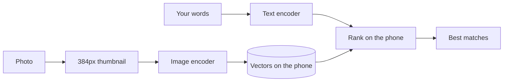

# SmartGalleryX

Search your phone's photos by describing them: "a person jumping on a mountain", "friends at a dinner table".

No tags and no albums. A fine-tuned vision-language model understands what's in each photo, and the search index stays on your phone.

## Results

Scored on held-out test photos: how often the right photo appears for its caption.

| Test set | Top 1 | Top 5 | Top 10 |
|---|---|---|---|
| Flickr30k (1,000 photos) | 90.1% | 98.3% | 99.2% |
| COCO val2017 (5,000 photos) | 64.0% | 85.5% | 91.2% |

Fine-tuning raised top-1 retrieval by 5.8 points on Flickr30k and 9.1 points on COCO. The Flickr30k test set is a random split made for this project, not the standard published split.

## How it works



The server stores no photos and no index. It reads each thumbnail, returns a vector, and keeps nothing, so restarting it loses nothing. Only new or edited photos are ever uploaded, and repeat searches work offline.

## Tech stack

| Part | Technology |
|---|---|
| Model | SigLIP 2 ViT-L/16 at 384px, fine-tuned with PyTorch and open_clip |
| Training data | COCO 2017 and Flickr30k: 146,070 images, 730,349 captions |
| Server | FastAPI on Kaggle GPUs, exposed through ngrok |
| App | Expo SDK 58, React Native, SQLite, FlashList |

## Project structure

```
app/        React Native app
backend/    FastAPI server and its Kaggle notebook
model/      Training pipeline and its Kaggle notebook
docs/       Technical documentation
```

## Documentation

- [How the model works](docs/MODEL.md): embeddings, architecture, training and results
- [System architecture](docs/ARCHITECTURE.md): the app, the server and the design decisions

## Running it

### 1. Train the model

Run `model/kaggle/smart-gallery-kaggle.ipynb` on Kaggle with GPU T4 x2 and internet on, with these datasets attached:

- `awsaf49/coco-2017-dataset`
- `hsankesara/flickr-image-dataset`

The run takes about 7 hours and produces `smart_gallery_model.pt`.

### 2. Start the server

Run `backend/kaggle/smart-gallery-backend.ipynb` on Kaggle with the training notebook's output attached as an input, and add these secrets:

| Secret | Value |
|---|---|
| `NGROK_AUTH_TOKEN` | Your ngrok token |
| `SMART_GALLERY_API_KEY` | A long random password you create |
| `NGROK_DOMAIN` | Optional fixed ngrok domain |

The notebook prints a `SERVER URL` when it's ready. To change the server code, edit `backend/server.py` and run `python backend/build_notebook.py`.

### 3. Run the app

```bash
cd app
npm install
npm test
npx expo prebuild --platform ios
npx expo run:ios --device
```

The app uses native modules, so it needs a development build rather than Expo Go. In the app's Settings, enter the server URL and your API key. Indexing then starts on its own.

## Limitations

- Kaggle sessions are temporary, so this is a personal project setup, not production hosting.
- New searches need the server to be running.
- Thumbnails reach the server to be read, though they aren't kept.
- It has been tested on an iPhone 17, but not yet on an Android phone.

## License

[MIT](LICENSE)

## Contact

**Manish Agarwal**

- GitHub: [@mani5h-agarwal](https://github.com/mani5h-agarwal)
- LinkedIn: [Connect with me](https://www.linkedin.com/in/manish-agarwal-34539a28a/)
