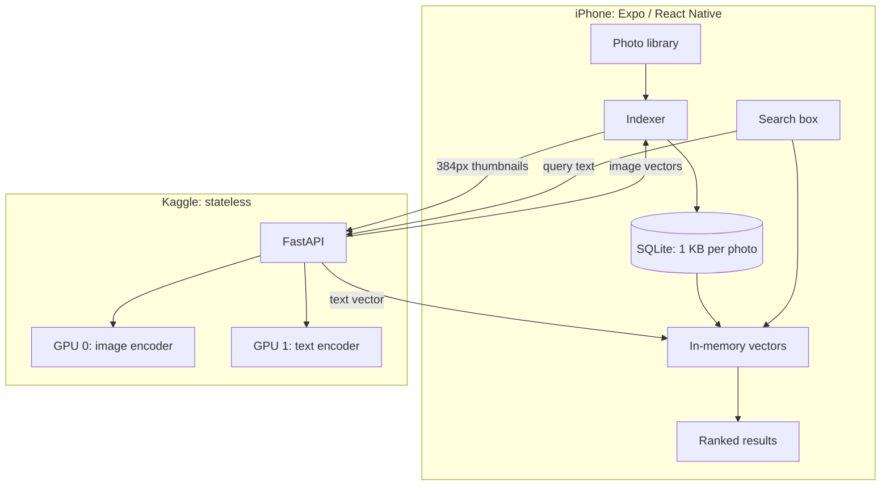
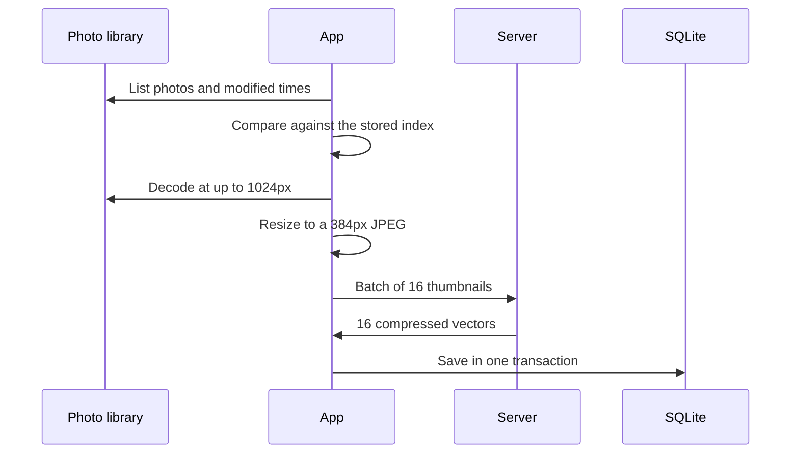

# SmartGalleryX Architecture

This document explains how the app and server work together, and why they were designed this way. For the model itself, see [MODEL.md](MODEL.md).

## Overview

## The key decision: a stateless server

The first backend stored full photos and a vector database on the server. Kaggle sessions are temporary, so the entire index vanished whenever a session ended.

The new server stores nothing:

| | Old design | New design |
|---|---|---|
| Index lives on | Server's temporary disk | The phone |
| After a server restart | Index lost | Nothing lost |
| Photos on the server | Full-size files saved to disk | Thumbnails processed, then discarded |
| Upload per photo | Full photo as base64 | About 31 KB |
| Security | None | API key on every embedding request |
| Ranking | Server | Phone |

The phone pays for this with local storage and the work of ranking, both of which are small at this scale.

## Indexing a photo

- **Changes only:** a photo is sent only if it's new or its modified time changed. Deleted photos are removed from the index.
- **Resumable:** every finished batch is saved at once, so a crash loses only the batches in progress.
- **Failures:** photos that can't be read are retried up to 3 times, then skipped until they change.
- **Safety check:** an empty library read leaves the index alone, because it's far more likely to be a permission change than a wiped library.

## Searching

1. The query is trimmed and lowercased.
2. The app checks its cache of query vectors. If there's no match, the server encodes the text.
3. The app computes the dot product with every stored vector.
4. A min-heap keeps the top 60 without sorting the whole library.
5. The app loads details for those photos and shows them.

**Why vectors live in one `Int8Array`:** a single flat block of memory avoids thousands of JavaScript objects.

**Keeping the UI smooth:** the Hermes JavaScript engine has no JIT compiler, so a search hands control back to the UI every 2,048 photos. A newer search cancels an older one.

**Cost:** ranking needs N × 1,024 multiplications. That's about 10 million for 10,000 photos. On-device search speed hasn't been measured yet.

**Offline use:** repeat searches use their cached vectors, so they work with no server.

**Model changes:** vectors from different models can't be compared. The server reports a fingerprint of its weights, and the app rebuilds its index if that changes.

## Server API

| Route | Key needed | Purpose |
|---|---|---|
| `GET /health` | No | Model details, used to confirm the server is running |
| `POST /embed/images` | Yes | Up to 32 images, 8 MB each. Unreadable ones return `null` |
| `POST /embed/text` | Yes | Up to 16 queries. Includes an LRU cache of 4,096 |

Using one GPU per encoder means an indexing run on one can't hold up a search on the other.

### Measured server performance

| Measure | Result |
|---|---|
| Average thumbnail | 31 KB |
| Image embedding | 31 to 35 images per second, in a test on Kaggle |
| Text search latency | Measured by the self-test, but the value wasn't recorded |

## App structure

| File | Role |
|---|---|
| `app/src/state/GalleryContext.js` | Connection, indexing and search state |
| `app/src/lib/vectors.js` | Vector storage, decoding and ranking |
| `app/src/lib/indexer.js` | Sync logic, written with injected dependencies so it's testable |
| `app/src/lib/api.js` | Server requests and error types |
| `app/src/lib/db.js` | SQLite: photos, failures, cached queries, settings |
| `app/src/lib/photos.js` | Photo library access and thumbnails |
| `app/src/screens/` | Gallery, viewer and settings |

There are 49 automated tests, covering ranking, sync rules, API handling and screens.

## Notable bugs and what they taught

These were all found by running the real system. They show why a passing test suite isn't enough.

### Out of memory during training

Training crashed in its first steps even though a batch-size probe had approved the batch. Gradients from the previous step were still in memory during the next forward pass, and the probe had never measured that together with the optimizer's memory.

**Fix:** clear gradients straight after each step, and make the probe run two real steps.

### Random search failures from a cache

The self-test crashed with a `KeyError` after thousands of queries. Adding new items could evict a query from the same request just before it was read back.

**Fix:** build each response from a local copy, and protect the cache with a lock.

### "Server offline" that wasn't

The app showed "Connected", then "Server offline". The server was fine. Expo SDK 58's `fetch` doesn't accept React Native's `{ uri }` file uploads, so uploads failed on the phone before sending, and a broad `catch` reported that as offline. Tests had mocked `fetch`, so they never ran the real code.

**Fix:** build the multipart request as raw bytes, and check the format with a real parser.

**Lesson:** a catch-all error handler can hide the real cause.

### The app killed at launch

After 110 photos, the app died, then died within 3 seconds of every launch. There was no crash report, because iOS had killed it for using 3.5 GB of memory. The evidence was a Jetsam log on the phone. Thirty-two full photos were being decoded at once, and the sync resumed at the same batch on each launch.

**Fix:** decode at up to 1024px, make at most 4 thumbnails at a time, load grid images through `ph://` addresses so iOS supplies them at tile size, and cap the image cache at 150 MB.

**Lesson:** on a phone, resource limits are a correctness problem.

## Limitations

- **Server hours:** Kaggle stops after about 12 hours at most, and the notebook stops itself after 60 idle minutes. It also uses limited weekly GPU time, so this isn't production hosting.
- **Single key:** there's one shared API key and no user accounts.
- **Thumbnails leave the phone:** they aren't kept, but they do reach the server to be read.
- **iCloud photos:** photos stored only in iCloud may fail to index.
- **Foreground only:** indexing pauses when the app is in the background.
- **Android:** the app builds for Android but hasn't been run on an Android phone.
- **Library size:** large-library performance hasn't been measured.
