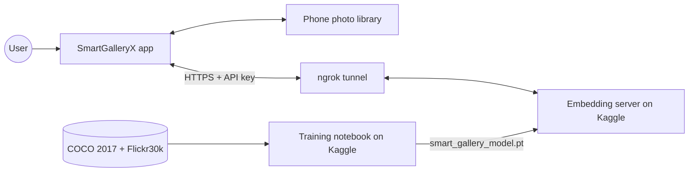
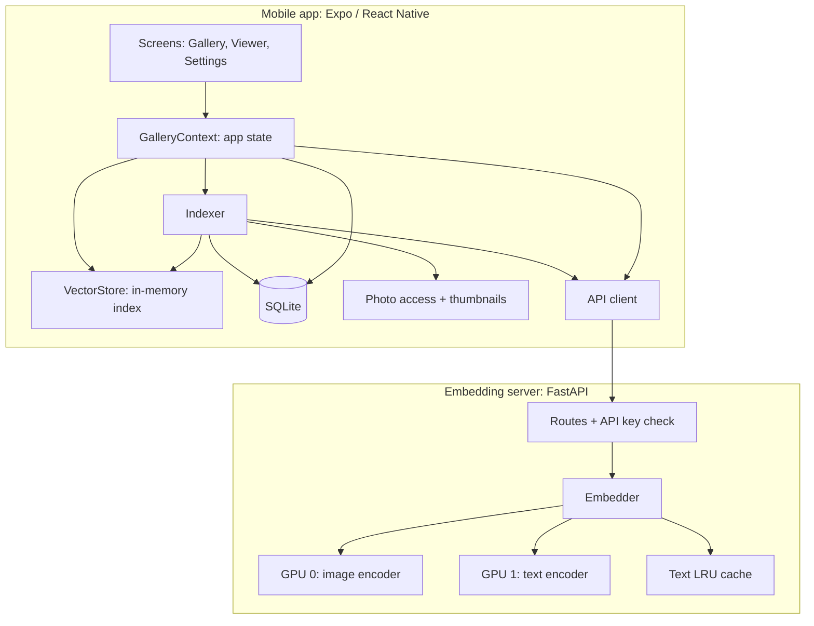
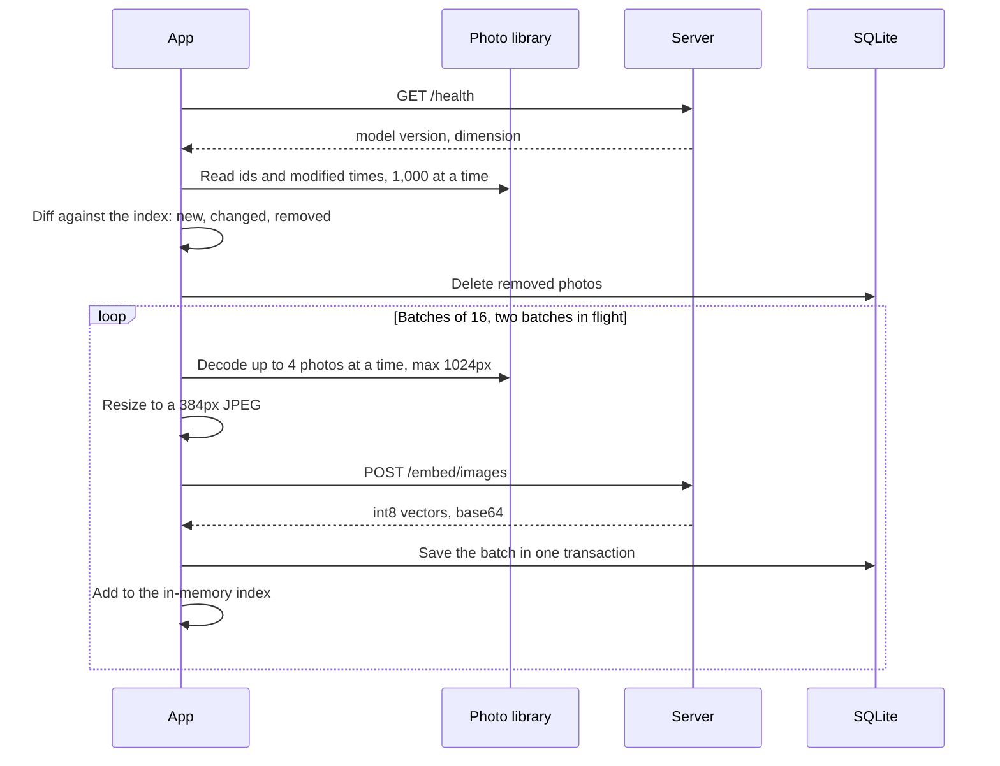
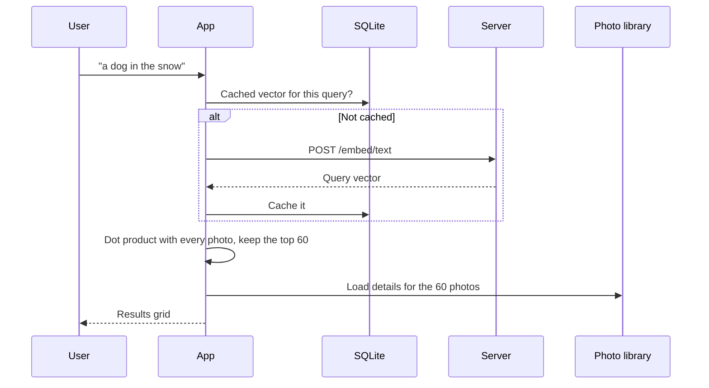
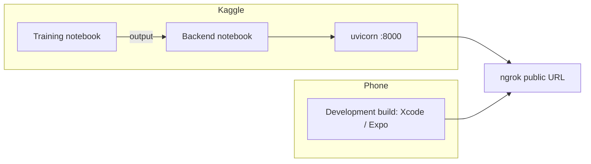

# SmartGalleryX: High-Level Design

This document describes the system at the level of components, data flows and design decisions. For classes, schemas and algorithms, see [LLD.md](LLD.md). For the model, see [MODEL.md](MODEL.md).

## 1. Purpose

SmartGalleryX lets a person search their phone's photo library with plain language, such as "a person jumping on a mountain". It needs no tags, albums or manual labelling.

## 2. Requirements

### Functional

| ID | Requirement |
|---|---|
| F1 | Search the photo library with a free-text description |
| F2 | Index the library automatically, and keep the index in step as photos are added, edited or deleted |
| F3 | Show the best matches in a grid, with a full-screen viewer, zoom and share |
| F4 | Let the user connect to a server with a URL and an API key |
| F5 | Let the user pause indexing, limit it to Wi-Fi, or rebuild the index |
| F6 | Keep recent searches, and allow them to be removed |

### Non-functional

| Area | Target |
|---|---|
| Accuracy | Strong text-to-image retrieval on general photos. Achieved R@1 90.1% on Flickr30k and 64.0% on COCO, R@10 99.2% and 91.2% |
| Privacy | No photos and no index stored on the server |
| Durability | A server restart loses nothing |
| Efficiency | Small uploads; only new or changed photos are sent |
| Responsiveness | Search must not freeze the UI |
| Memory | Must stay within iOS memory limits on large libraries |
| Cost | Runs on free resources: Kaggle GPUs and an ngrok tunnel |

## 3. System context

The system has three parts, used at different times:

| Part | Runs | Job |
|---|---|---|
| Training pipeline | Once, offline, on Kaggle T4 x2 | Fine-tunes SigLIP 2 into `smart_gallery_model.pt` |
| Embedding server | On demand, on Kaggle T4 x2 | Turns thumbnails and queries into vectors |
| Mobile app | On the phone | Indexes, stores vectors, ranks results, shows photos |

## 4. Components

### 4.1 Training pipeline (`model/`)

- Loads COCO 2017 and Flickr30k: 146,070 training images and 730,349 captions.
- Fine-tunes SigLIP 2 ViT-L/16 at 384px with a sigmoid contrastive loss across both GPUs.
- Picks the checkpoint with the best validation MRR, and tests it on held-out sets.

The details are in [MODEL.md](MODEL.md).

### 4.2 Embedding server (`backend/`)

- A stateless FastAPI service. It returns vectors and keeps nothing.
- The image encoder runs on one GPU and the text encoder on the other, so indexing never slows a search.
- Vectors are sent as int8, at 1 KB per photo rather than 4 KB as float32.
- The notebook exposes the server through ngrok, and stops itself after 60 idle minutes or 11 hours.

### 4.3 Mobile app (`app/`)

| Component | Responsibility |
|---|---|
| Screens | Grid, search bar, status banner, viewer, settings |
| GalleryContext | Connection state, indexing control, search, settings |
| Indexer | Compares the library with the index and uploads only the differences |
| VectorStore | Holds every vector in one `Int8Array` and finds the top results |
| SQLite | Stores vectors, failed photos, cached queries and settings |
| SecureStore | Stores the API key in the iOS Keychain or Android Keystore |
| Photo access | Reads library pages and makes 384px thumbnails |
| API client | Sends requests and sorts errors into kinds |

## 5. Main flows

### 5.1 Indexing

### 5.2 Searching

### 5.3 Model change

The server reports a fingerprint of its weights with every response. If the fingerprint differs from the one the app stored, the app clears its index and re-indexes, because vectors from different models can't be compared.

## 6. Data

| Data | Where it lives | Size |
|---|---|---|
| Photos | Phone library only | Unchanged |
| Photo vectors | SQLite and memory on the phone | 1 KB per photo: 10 MB for 10,000 photos |
| Query vectors | SQLite on the phone, up to 500 | 1 KB each |
| Server URL, settings | SQLite `meta` table | Bytes |
| API key | SecureStore | Bytes |
| Thumbnails | Phone cache during upload, server memory during encoding | About 31 KB each, deleted after use |
| Model weights | Kaggle notebook output | Several GB |

## 7. Key design decisions

| Decision | Chosen | Alternative | Why |
|---|---|---|---|
| Where the index lives | On the phone | Vector database on the server | Kaggle sessions are temporary, so a server index was lost on every restart |
| Where ranking happens | On the phone | On the server | A brute-force scan of 1,024-dim int8 vectors is cheap at personal-library scale, and keeps the server stateless |
| Vector format | int8, scale 512 | float32 | Four times smaller to send and store |
| What is uploaded | 384px JPEG | Full photo | The model's input is 384px, so more pixels add only upload time |
| Encoders | One GPU each | Both on one GPU | Indexing can't hold up a search |
| Sync | Diff by modified time | Re-index everything | Only changes are sent; a crash loses at most the batches in flight |
| Authentication | One shared API key | User accounts | Enough for 2 or 3 personal users |
| Model | Fine-tuned SigLIP 2 ViT-L/16 384 | The earlier ViT + BERT model | Much higher accuracy; see [MODEL.md](MODEL.md) |

## 8. Quality attributes

### Performance

- The server embeds 31 to 35 images per second in a test on Kaggle.
- Ranking costs N × 1,024 multiply-adds, about 10 million for 10,000 photos. On-device timing hasn't been measured.
- Repeat searches skip the network, because query vectors are cached.

### Reliability

- Each finished batch is saved at once, so indexing resumes where it stopped.
- A photo that fails 3 times is skipped until it changes.
- An empty library read never wipes the index.
- When the server is offline, the app retries every 20 seconds.

### Security and privacy

- Every embedding request needs the API key, which is compared in constant time.
- The key is kept in SecureStore, never in code or plain storage.
- The server writes no photos to disk and keeps no logs of them.
- The link is HTTPS through ngrok.

### Memory

- Photos are decoded at up to 1024px, and at most 4 at a time.
- The grid loads images by `ph://` address on iOS, so the system supplies them at tile size.
- The image cache is capped at 150 MB.

### Scalability

The design targets one personal library per phone and 2 or 3 users per server. The phone's index scales linearly with the number of photos. Each server request is independent, so more server instances could be added behind a load balancer if needed.

## 9. Deployment

1. Run the training notebook once. Its output holds `smart_gallery_model.pt`.
2. Run the backend notebook with that output attached and the secrets `NGROK_AUTH_TOKEN` and `SMART_GALLERY_API_KEY` added, plus `NGROK_DOMAIN` if wanted.
3. Enter the printed URL and the key in the app's Settings.

## 10. Constraints and future work

| Constraint | Possible improvement |
|---|---|
| Kaggle sessions last at most about 12 hours | Host the server on an always-on machine, such as a free cloud VM on CPU |
| One shared API key | Per-user keys |
| Indexing runs only in the foreground | Background tasks |
| Thumbnails reach the server | Run the image encoder on the phone, with a smaller or quantized model |
| Brute-force ranking | An approximate nearest-neighbour index for very large libraries |
| Android not yet tested | Test on an Android phone |
