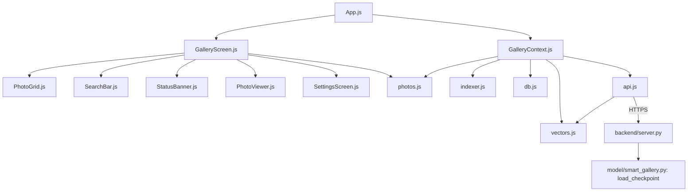
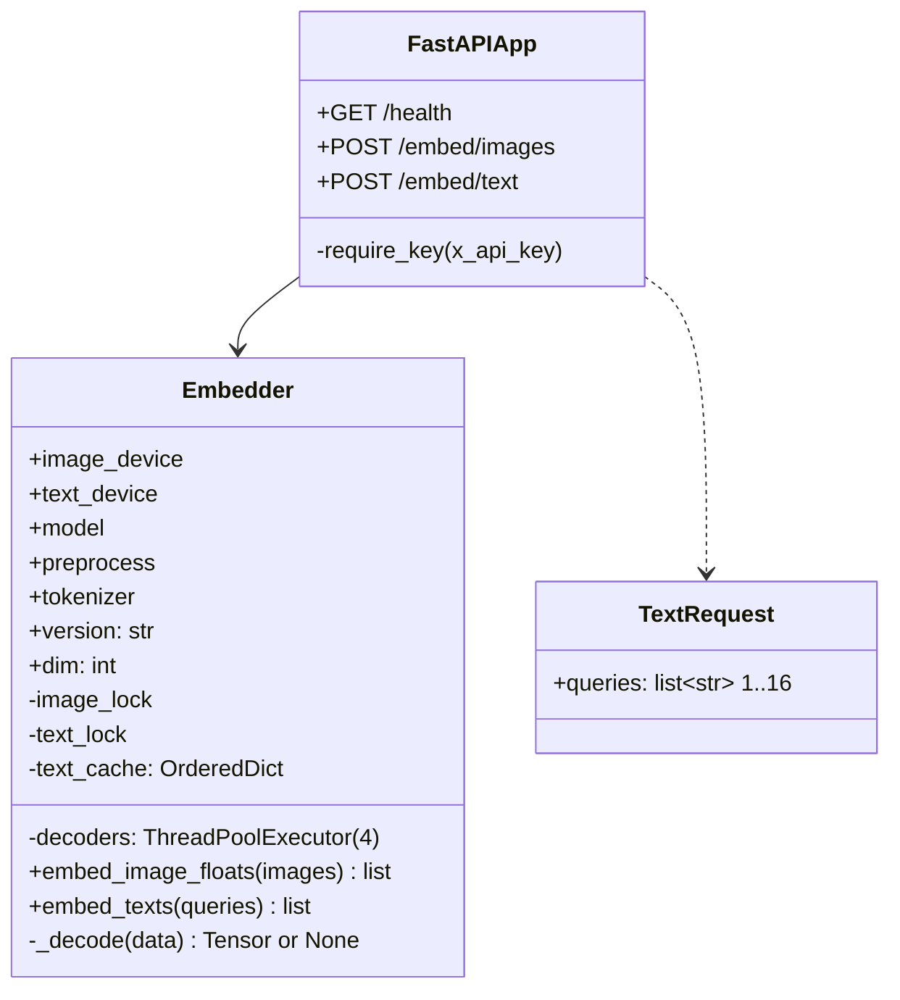
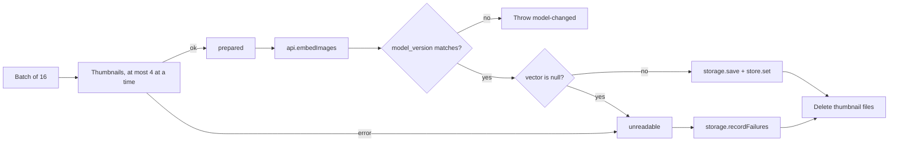
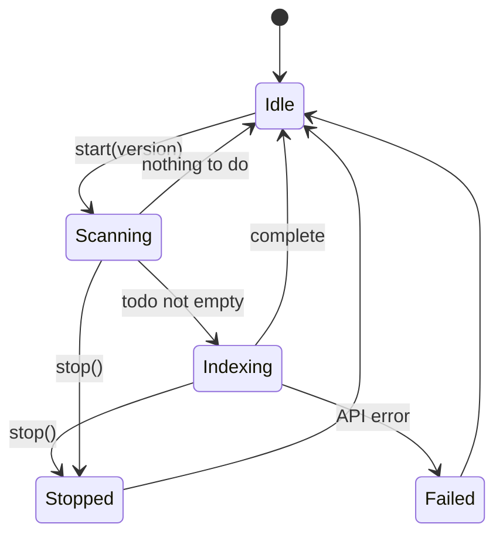
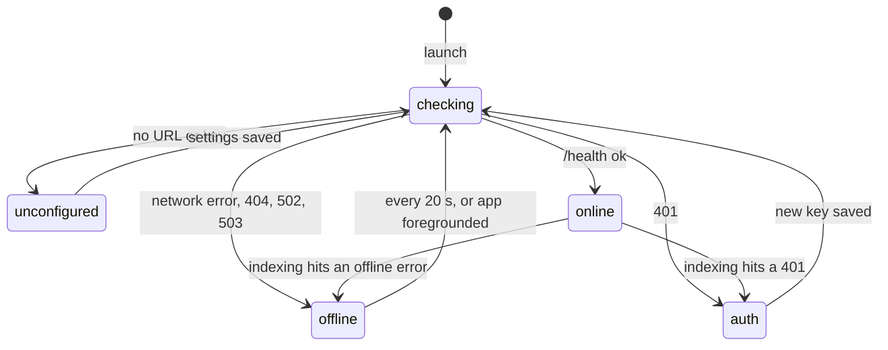

# SmartGalleryX: Low-Level Design

This document describes the modules, interfaces, data structures and algorithms. For the system view, see [HLD.md](HLD.md).

## 1. Module map



| Module | Main exports |
|---|---|
| `backend/server.py` | `Embedder`, `create_app`, `quantize`, `encode_vector`, `model_fingerprint` |
| `app/src/lib/api.js` | `ApiError`, `fetchHealth`, `embedImages`, `embedText`, `encodeImagesForm`, `normalizeServerUrl` |
| `app/src/lib/vectors.js` | `VectorStore`, `decodeVector` |
| `app/src/lib/db.js` | `openDb`, `get/setMeta`, `readPhotos`, `savePhotos`, `deletePhotos`, `recordFailures`, `readGivenUp`, `clearIndex`, query cache functions |
| `app/src/lib/indexer.js` | `createIndexer` |
| `app/src/lib/photos.js` | `readLibraryPage`, `readGalleryPage`, `readPhotosById`, `thumbnails`, `exportForSharing`, permission helpers |
| `app/src/state/GalleryContext.js` | `GalleryProvider`, `useGallery` |

## 2. Server

### 2.1 Classes



### 2.2 Embedder

**Start-up**

1. Picks `cuda:0` for the image tower and the last GPU for the text tower, or the CPU if there's no GPU.
2. Loads the checkpoint with `load_checkpoint`, then moves `model.text` to the text device.
3. Sets `version` to the first 12 hex characters of SHA-256 over the file size and its first 1 MB.
4. Sets `dim` by encoding "a photo".

**`embed_image_floats(images)`**

1. Decodes the bytes on 4 threads: PIL open, EXIF rotation, RGB, model preprocessing. A decode error gives `None`.
2. Stacks the readable images into one batch.
3. Under `image_lock`, with `inference_mode` and autocast, runs `encode_image(normalize=True)`.
4. Returns float32 vectors in input order, with `None` where an image couldn't be read.

**`embed_texts(queries)`**

All of it runs under `text_lock`:

1. Removes duplicate queries, keeping their order.
2. Looks up each query in the LRU cache. A hit is moved to the end and copied into a local `found` dict.
3. Tokenizes and encodes the misses in one batch, then adds them to `found` and the cache.
4. Evicts the oldest entries while the cache holds more than 4,096.
5. Builds the result from `found`, so an eviction during step 4 can't lose a query from this request.

If there's only one GPU, both locks are the same lock.

### 2.3 API

All responses are JSON. The `X-API-Key` header is compared with `hmac.compare_digest`.

**`GET /health`**: no key needed.

```json
{
  "status": "ok",
  "model": "ViT-L-16-SigLIP2-384",
  "model_version": "3f9a0c1b2d4e",
  "dim": 1024,
  "quant_scale": 512.0,
  "max_files": 32,
  "gpus": 2
}
```

The values shown are examples.

**`POST /embed/images`**: `multipart/form-data`, one or more `files` parts.

```json
{ "model_version": "3f9a0c1b2d4e", "vectors": ["<base64 of 1,024 int8>", null] }
```

**`POST /embed/text`**: body `{"queries": ["a dog in the snow"]}`. The server trims, lowercases and cuts each query to 300 characters.

```json
{ "model_version": "3f9a0c1b2d4e", "vectors": ["<base64 of 1,024 int8>"] }
```

| Status | When |
|---|---|
| 401 | Missing or wrong API key |
| 413 | More than 32 files, or a file over 8 MB |
| 422 | Bad JSON, more than 16 queries, or an empty query |

Model work runs through `run_in_threadpool`, so the event loop is never blocked.

### 2.4 Vector encoding

```
q = clip(round(v × 512), −127, 127) as int8
wire = base64(q bytes)
```

`v` is a unit vector, so each component is small and the scale of 512 keeps most of the int8 range in use. The app ranks with integer dot products of the int8 values. Because every vector uses the same scale, the order matches that of the float scores, apart from rounding.

### 2.5 Notebook runtime

| Setting | Value |
|---|---|
| Bind | uvicorn on 127.0.0.1:8000, in a background thread |
| Public access | ngrok tunnel, optionally on a fixed domain |
| Idle stop | 60 minutes with no keyed request |
| Hard stop | 11 hours |
| Self-test | 1,000 COCO images, checks the API and the cost of compression |

`backend/server.py` is the source of truth. `backend/build_notebook.py` writes it into the notebook.

## 3. App data layer

### 3.1 SQLite schema

The database is `smart-gallery.db`, opened with WAL journaling.

```sql
CREATE TABLE meta (
  key   TEXT PRIMARY KEY,
  value TEXT NOT NULL
);

CREATE TABLE photos (
  id          TEXT PRIMARY KEY,  -- media library id; ph://… on iOS
  modified_at REAL NOT NULL,     -- modified time when indexed
  vector      BLOB NOT NULL      -- 1,024 int8 bytes
);

CREATE TABLE failed (
  id          TEXT PRIMARY KEY,
  modified_at REAL NOT NULL,
  attempts    INTEGER NOT NULL
);

CREATE TABLE queries (
  query   TEXT PRIMARY KEY,      -- trimmed, lowercased
  vector  BLOB NOT NULL,
  used_at REAL NOT NULL          -- for LRU eviction
);
```

| `meta` key | Value |
|---|---|
| `server-url` | Normalized server URL |
| `model-version` | Fingerprint of the model the index was built with |
| `model-dim` | Vector dimension |
| `wifi-only` | `"1"` or `"0"` |

The API key isn't in SQLite. It's in SecureStore under `server-api-key`.

### 3.2 Operations

| Function | Behaviour |
|---|---|
| `readPhotos(onPhoto)` | Keyset paging by `id`, 2,000 rows at a time, so memory stays flat |
| `savePhotos(photos)` | One transaction: upsert each photo, clear its `failed` row |
| `deletePhotos(ids)` | One transaction: remove from `photos` and `failed` |
| `recordFailures(photos)` | Upsert. Adds 1 to `attempts` if `modified_at` is unchanged, else resets it to 1 |
| `readGivenUp()` | Photos with `attempts >= 3`, as a map of id to modified time |
| `clearIndex()` | Empties `photos`, `failed` and `queries` |
| `readCachedQuery(q)` | Returns a copy of the vector, and updates `used_at` |
| `cacheQuery(q, v)` | Upserts, then keeps only the newest 500 |
| `readRecentQueries(n)` | The newest `n` queries; the app asks for 6 |

## 4. VectorStore

### 4.1 Layout

```
ids:  ["ph://A", "ph://B", "ph://C", ...]        row → id
rows: Map { "ph://A" → 0, "ph://B" → 1, ... }    id → row
data: Int8Array  [ A0 … A1023 | B0 … B1023 | C0 … C1023 | ... ]
```

- `data` starts with room for 1,024 rows and doubles when full.
- `set(id, v)` checks the dimension, then overwrites the existing row or appends a new one.
- `delete(id)` moves the last row into the deleted row's place, so the array stays packed. This is O(dim).

### 4.2 Search

```
search(query, k, shouldStop):
    heap = min-heap ordered by score, at most k items
    for row in 0 .. count−1:
        if row > 0 and row % 2048 == 0:
            yield to the event loop
            if shouldStop(): return null
        score = Σ data[row·dim + i] × query[i]
        if heap.size < k: push (row, score)
        else if score > heap.min: replace the min, sift down
    return heap sorted by score descending, ties by row
```

| Measure | Cost |
|---|---|
| Time | O(N × dim + N log k) |
| Extra memory | O(k) |
| UI blocking | At most 2,048 rows between yields |

`shouldStop` is `token !== live.searchToken`, so a newer search cancels an older one.

## 5. Indexer

`createIndexer({ library, thumbnails, api, storage, store, onProgress })` receives all its dependencies, so the tests can drive it with fakes.

### 5.1 Constants

| Name | Value | Purpose |
|---|---|---|
| `BATCH_SIZE` | 16 | Photos per upload |
| `PARALLEL_UPLOADS` | 2 | Workers, each with one batch in flight |
| `PARALLEL_THUMBNAILS` | 4 | Decodes at once, shared by all workers |
| `SCAN_PAGE_SIZE` | 1,000 | Library rows per read |

### 5.2 Scan

```
known   = id → modified_at of indexed photos
givenUp = id → modified_at of photos that failed 3 times
for each page of the library, newest first:
    for each photo:
        seen.add(id)
        skip if known[id] == modifiedAt
        skip if givenUp[id] == modifiedAt
        todo.push(photo)
removed = seen is empty ? [] : known ids not in seen
```

The empty check stops a failed read or a permission change from deleting the whole index.

### 5.3 Batch pipeline



Thumbnail files are deleted in a `finally` block, so they're removed even when the upload fails.

### 5.4 States



- `start` returns the run in progress if there is one, rather than starting a second.
- If one worker fails, it sets `stopRequested` so the other stops after its current batch. `Promise.allSettled` waits for both before the error is thrown.
- `stop()` waits for the run to finish.

## 6. GalleryContext

### 6.1 State

| React state | Values |
|---|---|
| `connection` | `unconfigured`, `checking`, `online`, `offline`, `auth` |
| `progress` | `{ phase: "idle" \| "scanning" \| "indexing", done, total }` |
| `indexedCount` | Photos in the index |
| `paused`, `wifiOnly`, `waitingForWifi` | Indexing controls |
| `indexError` | Message for errors other than offline and auth |
| `libraryVersion` | Bumped to make the grid reload |

A `live` ref holds values that callbacks need without re-rendering: `store`, `known`, `modelVersion`, `indexer`, `server`, `searchToken`, and flags for pause, Wi-Fi and permission.

### 6.2 Connection



On a successful health check:

1. If the stored `model-version` differs, stop the indexer, clear the index and rebuild the store.
2. If there's no store, or its dimension differs, build it from SQLite.
3. Save the version and dimension, set `online`, and start a sync.

### 6.3 Events

| Event | Action |
|---|---|
| Launch | Load settings and the key; build the store from SQLite if a dimension is saved; check the server |
| App to foreground | Re-check permission and server; reload the grid |
| App to background | Stop the indexer |
| Library changed | Wait 3 s with debounce, then reload the grid and sync |
| Sync requested while running | Set `syncAgain` and run once more afterwards |
| Wi-Fi only, not on Wi-Fi | Skip the sync and show "Indexing resumes on Wi-Fi" |

### 6.4 Search

```
search(raw):
    q = raw.trim().toLowerCase()
    token = ++searchToken
    if index empty: return []
    v = readCachedQuery(q)
    if not v:
        r = embedText(server, q)
        if r.modelVersion != modelVersion:
            checkServer()      // which triggers the re-index
            throw "The model was updated"
        v = r.vector; cacheQuery(q, v)
    ranked = store.search(v, 60, () => token != searchToken)
    if cancelled: return null
    photos = readPhotosById(ranked ids)   // drops deleted photos
    return token == searchToken ? { q, photos } : null
```

A `null` result means a newer search replaced this one, and the screen ignores it.

## 7. API client

### 7.1 Request wrapper

Every request:

- adds `X-API-Key` and `ngrok-skip-browser-warning` headers;
- uses an `AbortController` timeout of 30 s, or 90 s for image uploads;
- maps every failure to an `ApiError` with a `kind`.

| Cause | `kind` | Shown as |
|---|---|---|
| `fetch` throws: no network, DNS, timeout | `offline` | Server offline |
| 401 | `auth` | API key rejected |
| 404, 502, 503 (ngrok tunnel with no notebook) | `offline` | Server offline |
| Other 4xx | `rejected` | Error message |
| Other 5xx | `server` | Error message |
| Body isn't JSON (an ngrok error page) | `offline` | Server offline |

### 7.2 Multipart body

Expo's `fetch` doesn't accept React Native's `{ uri }` form parts, so `encodeImagesForm` builds the body as bytes:

```
--<boundary>\r\n
Content-Disposition: form-data; name="files"; filename="0.jpg"\r\n
Content-Type: image/jpeg\r\n\r\n
<jpeg bytes>\r\n
... one part per image ...
--<boundary>--\r\n
```

The boundary is `SmartGallery` plus a timestamp and random text.

### 7.3 Decoding

`decodeVector` turns base64 into bytes with `atob`, then maps each byte above 127 to `byte − 256`, giving an `Int8Array`.

## 8. Photo access

| Function | Detail |
|---|---|
| `readLibraryPage` | Metadata only, newest first: `{ id, modifiedAt }`. No URIs, so scans stay fast |
| `readGalleryPage` | Grid pages of 120. On iOS the `ph://` id is used as the image URI |
| `readPhotosById` | Details for search results. Missing photos are dropped |
| `thumbnails.create(id)` | Decodes at up to 1024 × 1024, resizes to 384 × 384, saves JPEG at quality 0.8 |
| `thumbnails.release(uris)` | Deletes the temporary files and ignores errors |
| `exportForSharing(uri)` | Full-size JPEG at quality 0.95 |

The thumbnail is squashed to a square because the model's preprocessing does the same, so sending the original aspect ratio would add nothing.

## 9. UI

| Component | Detail |
|---|---|
| `App.js` | Safe area, `GalleryProvider`, image cache capped at 150 MB and 400 images |
| `GalleryScreen` | Search bar, suggestion and recent-search chips, grid of the library or results |
| `PhotoGrid` | FlashList, 3 columns, 2 px gap, memoized tiles |
| `StatusBanner` | Shows the most important state: setup, key, offline, error, paused, Wi-Fi, progress. Its button pauses or resumes indexing |
| `PhotoViewer` | Swipe between photos, pinch to zoom, date, share |
| `SettingsScreen` | Server URL and key, connection status, Wi-Fi only, rebuild index. Pause and resume are on the status banner |

## 10. Error handling

| Failure | Handling |
|---|---|
| A thumbnail can't be made, e.g. iCloud only | Recorded as a failure; given up after 3 tries until the photo changes |
| The server can't read an image | Same as above |
| Server offline during indexing | Finished batches are kept; connection set to `offline`; retry every 20 s |
| Wrong key | Connection set to `auth`; banner links to Settings |
| Model changed | Index cleared and rebuilt |
| Photo deleted after indexing | Removed on the next scan; skipped in results |
| Empty library read | Index left alone |
| App killed during indexing | Resumes from the last saved batch |

## 11. Tests

There are 49 Jest tests:

| File | Covers |
|---|---|
| `vectors.test.js` | Decoding, store growth, swap-delete, ranking order, cancelling |
| `indexer.test.js` | Diffing, removals, empty-read guard, failures, model change, stop, worker errors |
| `api.test.js` | Headers, request formats, vector decoding, offline detection, multipart format checked with a real parser |
| `app.test.js` | Permission, setup and offline states, on-device search, offline repeat search, model change, settings, viewer |

The server is checked by the notebook's self-test on Kaggle.
