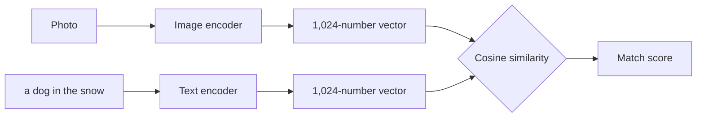
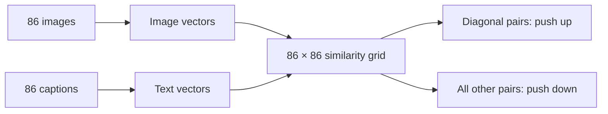

# The SmartGalleryX Model

This document explains how text-to-image search works here, from the core idea to the training details and results. It assumes you know basic Python and have heard of neural networks.

## 1. The problem

A user types "a person jumping on a mountain" and expects the right photo, even though nobody tagged that photo with any words.

Keyword search can't do this because photos contain pixels, not words. Image and text need to be made comparable.

## 2. The core idea: a shared embedding space

An **embedding** is a list of numbers that represents the meaning of something. Here, every photo and every sentence becomes a list of 1,024 numbers, called a vector.

The model is trained so that:

- A photo and a sentence describing it get vectors pointing in nearly the same direction.
- A photo and an unrelated sentence get vectors pointing in different directions.



Search then becomes simple: turn the query into a vector, compare it against every photo's vector, and return the closest ones.

This pair of encoders is called a **dual encoder** or **two-tower** model. The towers never see each other's input, so photo vectors can be computed once and stored. A search only has to encode the text. A model that read the photo and text together might score pairs slightly better, but it would have to run again on every photo for every search.

### Measuring similarity

Vectors are **normalized** to length 1, so only their direction matters. Similarity is then the **cosine similarity**, which for normalized vectors is just the dot product:

```
similarity(a, b) = a₁b₁ + a₂b₂ + … + a₁₀₂₄b₁₀₂₄
```

The result runs from +1 (same direction) through 0 (unrelated) to −1 (opposite). In this model, good matches often score only about 0.15 to 0.2. That's normal in a 1,024-dimensional space, so scores are used for ranking, not as percentages.

## 3. The architecture

The base model is **SigLIP 2 ViT-L/16 at 384px** (`ViT-L-16-SigLIP2-384` from `open_clip`), trained by Google on a very large web dataset of images and text.

| Property | Image tower | Text tower |
|---|---|---|
| Type | Vision Transformer (ViT-L) | Transformer |
| Layers | 24 | 24 |
| Layer width | 1,024 | 1,024 |
| Attention heads | 16 | 16 |
| Input | 384×384 pixels | Up to 64 tokens |
| Output | 1,024 numbers | 1,024 numbers |

### Image tower

1. **Patches:** the photo is resized to 384×384 and cut into 16×16 pieces. That gives 24×24 = **576 patches**.
2. **Patch embeddings:** each patch becomes a vector, and a position embedding records where it came from.
3. **Self-attention:** 24 transformer layers let every patch look at every other patch. This is how the model links a person, a mountain and the pose that means "jumping".
4. **Attention pooling:** a learned query summarizes all 576 patches into one vector.

Resizing squashes the photo to a square instead of cropping it, so the edges of a photo are never lost.

### Text tower

1. **Tokenizing:** text is lowercased, cleaned and split into tokens, then padded or cut to 64.
2. **Token embeddings:** each token becomes a vector from a table of 256,000 entries.
3. **Self-attention:** 24 layers work out the meaning of the words in context, so "a dog chasing a man" differs from "a man chasing a dog".
4. **Pooling:** the result is reduced to one vector in the shared space.

### Why a transformer can relate distant things

In **self-attention**, each token (a patch or a word) compares itself with all the others and decides which ones matter. Unlike a convolutional network, which builds up from small local regions, a ViT can connect opposite corners of a photo in its first layer.

## 4. Why fine-tune rather than train from scratch

**Transfer learning** means starting from a model that has already learned something and adapting it. It suits this project because a good retrieval model needs far more data and compute than a free Kaggle GPU offers.

The first version of this project used a ViT and BERT that had each been pretrained separately, on unrelated tasks, so their outputs had no shared meaning. Two epochs couldn't align them. This version starts from two towers already trained together.

**Choosing the base model.** Instead of assuming the newest model was best, the training notebook measured three candidates on the same validation set of 3,000 images:

| Model | R@1 | R@5 | R@10 |
|---|---|---|---|
| **SigLIP 2 ViT-L/16 384 (chosen)** | **69.6%** | **88.5%** | **93.3%** |
| SigLIP ViT-L/16 384 | 67.8% | 87.1% | 92.5% |
| DFN5B CLIP ViT-H/14 | 67.5% | 88.3% | 93.3% |

## 5. The data

| Dataset | What it adds |
|---|---|
| COCO 2017 | Everyday scenes, each with about 5 human-written captions |
| Flickr30k | Photos focused on people and activities, with 5 captions each |

| Split | Images | Captions | Used for |
|---|---|---|---|
| Train | 146,070 | 730,349 | Learning |
| Validation | 3,000 | 15,000 | Choosing the base model and the best checkpoint |
| COCO test | 5,000 | 25,000 | Final score |
| Flickr test | 1,000 | 5,000 | Final score |

The test sets were never trained on and never used for any decision, so the final scores are fair estimates.

**Sampling.** Each training item is one image with one randomly chosen caption. This means a batch can't contain the same image twice, and over the epochs the model sees different captions for each photo.

**Augmentation.** Augmentation creates variations of training images so the model generalizes better, but changes must not make the caption false:

- **Random crop:** keeps 70% to 100% of the image.
- **Horizontal flip:** skipped when the caption contains "left" or "right", because flipping would make it wrong.
- **No colour changes:** a colour shift would make "a red car" false. The original project's hue jitter had exactly this problem.

## 6. How it learns: the loss function

Training uses **contrastive learning**. Each batch here held 86 image-caption pairs, which gives 86 × 86 = 7,396 possible pairings. Only 86 of them are correct, so every image has 85 wrong captions to learn from. The first version compared each image with only one wrong caption, which is far weaker.



SigLIP uses a **sigmoid loss**. Every pair is treated as its own yes-or-no question: does this caption match this image?

```
logit(i, j) = t × cosine(image_i, text_j) + b
loss = − average over i of Σ_j log σ( z_ij × logit(i, j) )
```

- `σ` is the sigmoid function, which squashes any number into the range 0 to 1.
- `z_ij` is +1 for a correct pair and −1 for a wrong one.
- `t` is a learned **scale**. Cosine values are small, so it stretches them into a useful range.
- `b` is a learned **bias**. Most pairs are wrong, so a negative bias starts each pair near "no match".

Compared with the softmax loss used by CLIP, a sigmoid loss judges each pair independently rather than making all captions compete, and it has been reported to work well at smaller batch sizes.

### Gradients across two GPUs

To give each image the full 85 wrong captions, each GPU collects the vectors from the other GPU. Those copies carry no gradients, so each GPU only back-propagates through its own vectors. PyTorch's DistributedDataParallel then averages the gradients.

Averaging would make the gradient too small by a factor of 2, so the loss is multiplied by the number of GPUs. A test confirmed the two-process gradients match single-process gradients to within about 5×10⁻⁷.

## 7. Fine-tuning settings

| Setting | Value | Why |
|---|---|---|
| Optimizer | AdamW | Standard for transformers |
| Top learning rate | 1×10⁻⁵ | Pretrained weights need small changes |
| Layer-wise decay | 0.85 per layer | Early layers change much less than late ones |
| Frozen layers | First 8 blocks of each tower, plus embeddings | Saves memory and they barely learn anyway |
| Weight decay | 0.05 | Discourages overfitting |
| Warmup | 200 steps | Avoids a large early shock to the weights |
| LR schedule | Cosine decay to 0 | Large changes first, fine adjustments last |
| Gradient clipping | 1.0 | Limits unusually large updates |
| Precision | 16-bit mixed | Faster and uses less GPU memory |
| Batch | 43 per GPU, 86 total | Limited by GPU memory |
| Length | 3 epochs, 5,094 steps | About 6.6 hours on two T4 GPUs |

**Layer-wise learning rate decay.** Early layers learn general features such as edges and textures, and those are already good. Later layers are closer to the task. Each layer down gets 85% of the rate above it, so block 8 trains at about 7% of the top rate (0.85¹⁶ ≈ 0.074).

**Frozen layers.** Two T4 GPUs have about 14.5 GB of usable memory each. Adam stores two extra numbers per trainable parameter, so freezing layers saves memory on gradients and on optimizer state, which makes room for a larger batch. The token embedding table alone has about 262 million parameters (256,000 × 1,024).

**Gradient checkpointing.** This trades some compute for memory: instead of storing intermediate results during the forward pass, the model recomputes them during the backward pass.

**Checkpoint selection.** Validation ran 6 times during training. The pretrained weights were saved as the first checkpoint, and later ones only replaced them if they improved **MRR**. Fine-tuning therefore could not have ended up worse than the starting point on validation.

## 8. How accuracy is measured

For each caption in a test set, the model ranks every image, and the metric checks where the image that caption was written for appears.

| Metric | Meaning |
|---|---|
| **R@1** (Recall at 1) | How often the correct image is ranked first |
| **R@5, R@10** | How often it's in the top 5 or top 10 |
| **MRR** (Mean Reciprocal Rank) | The average of 1 ÷ rank, so first scores 1, second scores 0.5, and so on |

A gallery shows a grid of results, so R@5 and R@10 are closest to real use.

COCO's R@1 looks low partly because many of its images fit the same generic caption. If several photos truly show "a man riding a wave", the metric still counts only one of them as correct.

## 9. Results

### Final test scores

| Test set | Model | R@1 | R@5 | R@10 | MRR |
|---|---|---|---|---|---|
| Flickr30k, 1,000 photos | Pretrained | 84.3% | 96.3% | 98.0% | 0.896 |
| | **Fine-tuned** | **90.1%** | **98.3%** | **99.2%** | **0.937** |
| COCO, 5,000 photos | Pretrained | 55.0% | 77.6% | 84.8% | 0.654 |
| | **Fine-tuned** | **64.0%** | **85.5%** | **91.2%** | **0.736** |

Fine-tuning added 5.8 points to Flickr R@1 and 9.1 points to COCO R@1.

Treat these limits as part of the result:

- The Flickr test set is a random split made for this project, not the standard published split, so don't compare it directly with papers.
- The COCO test uses all 5,000 images of `val2017`. Papers often use a different COCO split, so compare carefully there too.

### Progress during training

| Step | Validation R@1 | R@5 | R@10 |
|---|---|---|---|
| 0 (pretrained) | 69.6% | 88.5% | 93.3% |
| 849 | 76.3% | 92.8% | 96.3% |
| 1,698 | 76.7% | 93.0% | 96.3% |
| 2,547 | 76.7% | 93.4% | 96.6% |
| 3,396 | 77.2% | 93.4% | 96.6% |
| 4,245 | 77.4% | 93.5% | 96.7% |
| 5,094 | 77.4% | 93.5% | 96.7% |

Most of the gain came in the first 849 steps, about a sixth of the run. The later gain was small and it had flattened out by the end, so more epochs of the same training are unlikely to help much.

Validation scores are higher than COCO test scores because the validation pool is smaller. Finding one image among 3,000 is easier than among 5,000, so these tables can't be compared with each other.

## 10. From training to the phone

The model is too large to run on a phone, so it runs on a Kaggle GPU, and each encoder has its own GPU. The stored vectors are compressed:

```
stored value = round(vector value × 512), limited to −127…+127
```

Each number then fits in one byte. A photo's vector takes 1 KB instead of 4 KB. Accurate rankings depend on those compressed values, and the backend's self-test was written to compare them against uncompressed vectors, but those two lines weren't recorded, so the loss in accuracy hasn't been documented.

[ARCHITECTURE.md](ARCHITECTURE.md) explains the rest of the system.

## 11. Limitations

- **Exact-match bias:** captions describe what's visible, so searches about personal meaning, like "my sister's graduation", can't work unless it's visually obvious.
- **Colours and fine details:** a 1,024-number summary can blur specifics. In one test, "a red car on the street" returned mostly near-misses, though the test gallery may have contained few or no red cars.
- **Text in photos:** the model isn't built to read text, so searching for words on a sign is unreliable.
- **Data bias:** COCO and Flickr30k reflect their own photos and caption writers, which may not match every person's gallery.
- **English:** the training data is English, so other languages weren't evaluated.
- **No validation on personal photos:** the scores come from public datasets, not from real phone galleries.

## 12. Ideas for future work

- **Re-ranking:** use a slower image-and-text model to reorder the top 50 results.
- **Soft labels:** near-duplicate captions in a batch are treated as wrong today, which trains against true matches.
- **Hard negative mining:** pick confusing examples on purpose.
- **Smaller on-device model:** remove the need for a server, likely at some cost in accuracy.
- **Personal evaluation set:** measure accuracy on real gallery photos.
